<!-- 
  ╔══════════════════════════════════════════════════════════════╗
  ║  🛸 MEBIN MOHANAN — GitHub Profile README                   ║
  ║  Theme: Cyberpunk Mission Control / HUD Dashboard            ║
  ║  Custom hand-crafted SVGs — no templates, no generators      ║
  ╚══════════════════════════════════════════════════════════════╝
-->

<!-- CUSTOM ANIMATED HEADER — Upload header.svg to your repo -->
<p align="center">
  
</p>

<!-- Quick Links Bar -->
<p align="center">
  <a href="https://www.linkedin.com/in/mebinmohan"></a>
  <a href="https://github.com/MebinMohanan"></a>
  
  
</p>

<br/>

<!-- ANIMATED DIVIDER — Upload divider.svg to your repo -->
<p align="center"></p>

<!-- ═══════════════════ BOOT SEQUENCE ═══════════════════ -->

<h2 align="center">⟐ SYSTEM BOOT ⟐</h2>

```
 ██████████████████████████████████████████████████████████████████████
 █                                                                    █
 █   > whoami                                                         █
 █   mebin_mohanan                                                    █
 █                                                                    █
 █   > cat /etc/role                                                  █
 █   Senior Solutions Engineer @ DifiNative Technologies              █
 █                                                                    █
 █   > cat /etc/mission                                               █
 █   Architect scalable systems. Bridge business & engineering.       █
 █   Ship solutions that work in the real world.                      █
 █                                                                    █
 █   > ls ~/expertise/                                                █
 █   solution-architecture/  api-design/  computer-vision/            █
 █   container-orchestration/  iot-pipelines/  pre-sales-eng/         █
 █                                                                    █
 █   > uptime                                                         █
 █   years of building, breaking, fixing, and shipping                █
 █                                                                    █
 ██████████████████████████████████████████████████████████████████████
```

<br/>

<p align="center"></p>

<!-- ═══════════════════ TECH ARSENAL ═══════════════════ -->

<h2 align="center">⟐ TECH ARSENAL ⟐</h2>

<table align="center">
<tr>
<td align="center" width="150">

**`LANGUAGES`**
<br/><br/>

<br/><br/>
`Python` · `JS` · `Bash`

</td>
<td align="center" width="150">

**`BACKEND`**
<br/><br/>

<br/><br/>
`FastAPI` · `SQLite`
<br/>`WebSockets` · `REST`

</td>
<td align="center" width="150">

**`DEVOPS`**
<br/><br/>

<br/><br/>
`Docker` · `K8s`
<br/>`Linux`

</td>
<td align="center" width="150">

**`AI & IOT`**
<br/><br/>

<br/><br/>
`OpenCV` · `AI/ML`
<br/>`MQTT` · `IoT`

</td>
<td align="center" width="150">

**`TOOLS`**
<br/><br/>

<br/><br/>
`Git` · `GitHub`
<br/>`VS Code`

</td>
</tr>
</table>

<br/>

<!-- Specialty badges -->
<p align="center">
  
  
  
  
</p>

<br/>

<p align="center"></p>

<!-- ═══════════════════ MISSION LOG ═══════════════════ -->

<h2 align="center">⟐ MISSION LOG ⟐</h2>

<br/>

<table align="center">
<tr>
<td width="50%">

<h3>🧬 <a href="https://github.com/MebinMohanan/appeal">APPEAL</a></h3>

> **AI-Powered Pediatric Evaluation Assistance Learning**

An intelligent system for early detection of child development abnormalities — because the best solutions save lives.

```
STATUS  ██████████████░░░░  Active
IMPACT  ◉◉◉◉◉  Healthcare + AI
STACK   Python · AI · Computer Vision
```

</td>
<td width="50%">

<h3>📡 <a href="https://github.com/MebinMohanan/SQLiteDB-MQTT">SQLiteDB-MQTT</a></h3>

> **IoT Data Pipeline Engine**

A lightweight, purpose-built bridge connecting SQLite persistence with MQTT messaging for seamless IoT data flows.

```
STATUS  ██████████████████  Production
IMPACT  ◉◉◉◉◎  IoT Infrastructure
STACK   Python · MQTT · SQLite
```

</td>
</tr>
<tr>
<td width="50%">

<h3>⚡ <a href="https://github.com/MebinMohanan/fastApi-webSocket">fastApi-webSocket</a></h3>

> **Real-time Communication Layer**

High-performance WebSocket service built on FastAPI — enabling real-time data streaming and live interactions.

```
STATUS  ██████████████████  Production
IMPACT  ◉◉◉◉◎  Backend Systems
STACK   Python · FastAPI · WebSockets
```

</td>
<td width="50%">

<h3>🌿 <a href="https://github.com/MebinMohanan/evora-beta">Evora</a></h3>

> **Web Platform — Beta**

Evolving web platform from concept through alpha to beta — iterating toward production readiness.

```
STATUS  ████████████░░░░░░  Beta
IMPACT  ◉◉◉◎◎  Web Platform
STACK   HTML · CSS · JavaScript
```

</td>
</tr>
</table>

<br/>

<p align="center"></p>

<!-- ═══════════════════ ANALYTICS ═══════════════════ -->

<h2 align="center">⟐ SYSTEM ANALYTICS ⟐</h2>

<br/>

<p align="center">
  
  &nbsp;&nbsp;
  
</p>

<p align="center">
  
</p>

<!-- Trophies -->
<p align="center">
  
</p>

<!-- Contribution Graph -->
<p align="center">
  
</p>

<br/>

<p align="center"></p>

<!-- ═══════════════════ CURRENT OPERATIONS ═══════════════════ -->

<h2 align="center">⟐ CURRENT OPERATIONS ⟐</h2>

<br/>

```
┌──────────────────────────────────────────────────────────────────┐
│                                                                  │
│   🔭 BUILDING    Scalable solution architectures for enterprise  │
│   🤖 EXPLORING   LLM integrations & agentic AI workflows        │
│   👁️ ADVANCING   Computer vision for real-world applications     │
│   ☸️ MASTERING   Kubernetes orchestration at scale               │
│   🌐 SHIPPING    Open-source tools & IoT pipelines              │
│                                                                  │
│   ◉ STATUS: ACTIVELY SEEKING COLLABORATIONS                     │
│                                                                  │
└──────────────────────────────────────────────────────────────────┘
```

<br/>

<!-- ═══════════════════ CONNECT ═══════════════════ -->

<h2 align="center">⟐ ESTABLISH CONNECTION ⟐</h2>

<p align="center">
  <a href="https://www.linkedin.com/in/mebinmohan">
    
  </a>
  &nbsp;
  <a href="https://github.com/MebinMohanan">
    
  </a>
</p>

<br/>

<!-- CUSTOM ANIMATED FOOTER — Upload footer.svg to your repo -->
<p align="center">
  
</p>

<!-- Snake animation — set up via GitHub Actions (instructions below) -->
<!--
<p align="center">
  
</p>
-->
